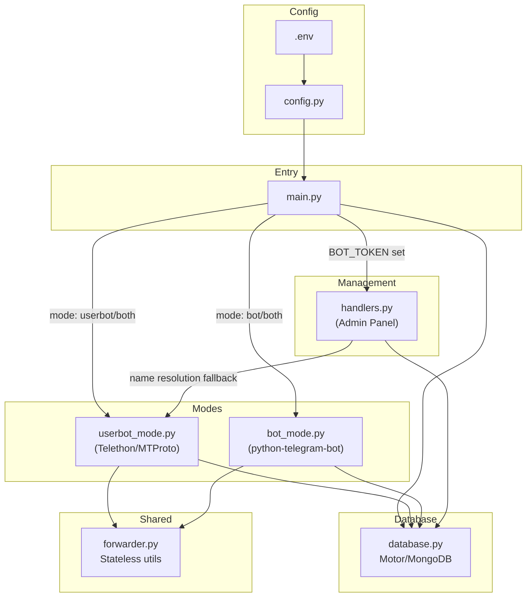
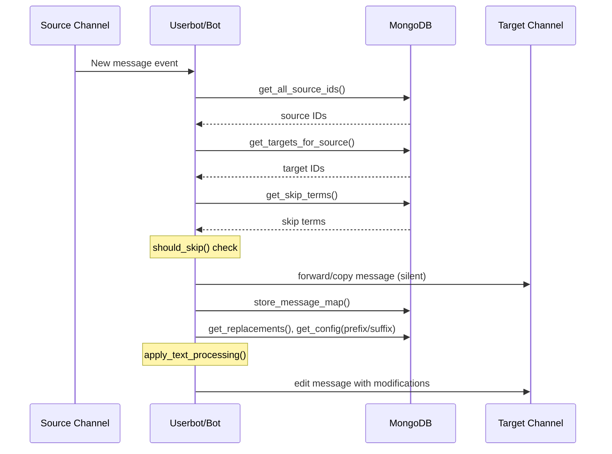

# 🔁 CT-Forwards — Codebase Analysis

## Overview

**Common Thread Auto Forward Bot** — A Python Telegram auto-forwarding solution that copies messages between channels **silently** (no "Forwarded From" header). Backed by **MongoDB** with a full inline-keyboard **admin panel**.

---

## Architecture

---

## File-by-File Breakdown

### [`main.py`](file:///d:/Project/Bots/Python/CT-Forwards/main.py) — Entry Point (156 lines)

| Responsibility | Detail |
|---|---|
| Mode orchestration | Reads `MODE` from DB (seeded from env), launches `userbot`, `bot`, or `both` |
| Health check | Optional HTTP server on `PORT` for Koyeb uptime monitors |
| Concurrency | `asyncio.gather()` runs PTB + Telethon simultaneously in `both` mode |
| Shared client | Builds Telethon client early so management panel can use it for channel name lookups |

> [!TIP]
> The `both` mode is an undocumented third option (README only mentions `userbot`/`bot`) — allows userbot forwarding + bot-mode forwarding simultaneously.

---

### [`config.py`](file:///d:/Project/Bots/Python/CT-Forwards/config.py) — Configuration (80 lines)

Loads all env vars and validates credentials. Key fields:

| Field | Source | Notes |
|---|---|---|
| `MODE` | `MODE` env | `userbot` / `bot` / `both` |
| `API_ID`, `API_HASH`, `SESSION_STRING` | env | Telethon credentials |
| `BOT_TOKEN` | env | PTB + management bot |
| `ADMIN_IDS` | env | Comma-separated user IDs for admin access |
| `MONGO_URL`, `MONGO_DB_NAME` | env | MongoDB connection |
| `FORWARD_RULES_RAW`, `SKIP_TERMS_RAW` | env | Seeded into DB on first run only |

---

### [`database.py`](file:///d:/Project/Bots/Python/CT-Forwards/database.py) — MongoDB Layer (236 lines)

Async MongoDB via **Motor**. All runtime config is stored here.

| Collection | Schema | Purpose |
|---|---|---|
| `config` | `{key, value}` | Key-value settings (mode, maintenance, prefix, suffix) |
| `forward_rules` | `{source_id, target_ids[]}` | Forwarding rules |
| `skip_terms` | `{term}` | Words/phrases to filter out |
| `replace_words` | `{from_word, to_word}` | Text replacements |
| `message_map` | `{source_chat_id, source_msg_id, target_chat_id, target_msg_id}` | Source→target mapping for edit/delete sync (7-day TTL) |

> [!NOTE]
> The `seed_from_config()` method is **idempotent** — it only imports env-var data if the DB collections are empty, enabling a smooth migration from env-only to DB-managed config.

---

### [`forwarder.py`](file:///d:/Project/Bots/Python/CT-Forwards/forwarder.py) — Shared Utils (103 lines)

Pure stateless functions shared by both modes:

- **`parse_rules_raw()`** — Parses `SOURCE:TARGET[,TARGET2];...` format into structured dicts
- **`resolve_chat_id()`** — Converts numeric strings to `int`, leaves usernames as-is
- **`apply_text_processing()`** — Pipeline: word replacements → prefix/suffix
- **`should_skip()`** — Case-insensitive term matching against text+caption

---

### [`modes/userbot_mode.py`](file:///d:/Project/Bots/Python/CT-Forwards/modes/userbot_mode.py) — Telethon Userbot (251 lines)

| Feature | Implementation |
|---|---|
| Silent forwarding | `client.forward_messages(drop_author=True)` |
| Album support | Debounce buffer (`ALBUM_WAIT_SECONDS=1.5s`) collects grouped media, then forwards together |
| Text processing | Forward first, then edit the copy with modifications (preserves media) |
| Edit sync | `events.MessageEdited` → looks up mapped targets → edits each copy |
| Delete sync | `events.MessageDeleted` → looks up mapped targets → deletes each copy |
| FloodWait handling | Catches `FloodWaitError`, sleeps, single retry |
| Source filtering | Queries DB for `source_ids` on every event (no in-memory caching) |

> [!IMPORTANT]
> The album debounce approach is well-designed — it uses `asyncio.Task` cancellation to reset the timer each time a new message in the same album arrives, then flushes the buffer after 1.5 seconds of silence.

---

### [`modes/bot_mode.py`](file:///d:/Project/Bots/Python/CT-Forwards/modes/bot_mode.py) — PTB Bot Mode (147 lines)

| Feature | Implementation |
|---|---|
| Silent copy | `ctx.bot.copy_message()` (no forwarded header) |
| Text processing | Copy first, then edit the copy (text → `edit_message_text`, media → `edit_message_caption`) |
| Edit sync | Handles `edited_channel_post` updates |
| Delete sync | ❌ **Not supported** — Bot API limitation |
| Album support | ❌ Each media item forwarded individually |

---

### [`management/handlers.py`](file:///d:/Project/Bots/Python/CT-Forwards/management/handlers.py) — Admin Panel (653 lines)

Full interactive Telegram UI with inline keyboards. The largest file in the project.

| Menu | Functions |
|---|---|
| 📋 Forward Rules | List (with channel name resolution), add (2-step), delete |
| ⚙️ Mode | Switch `userbot`/`bot`/`both` (restart required) |
| 🚫 Skip Terms | List, add, delete |
| 🔄 Replace Words | List, add (2-step find→replace), delete |
| 📝 Text Append | Set/clear prefix and suffix |
| 🔒 Maintenance | Toggle maintenance mode |
| 📊 Status | Live summary dashboard |

Key design decisions:
- **HTML parse mode** everywhere (avoids Markdown escaping issues)
- **`ConversationHandler`** for multi-step inputs with 5-minute timeout
- **Admin-only decorator** on all handlers with maintenance-mode awareness
- **Channel name resolution** falls back from PTB → Telethon → raw ID

---

## Data Flow

---

## Strengths

1. **Clean separation of concerns** — config, database, forwarding logic, modes, and management are all in distinct modules
2. **Dual-mode architecture** — Switching between userbot (MTProto) and bot (Bot API) via a single env var
3. **DB-backed runtime config** — All settings manageable via Telegram inline keyboards, no redeployment needed for rule changes
4. **Idempotent seeding** — Env vars bootstrap the DB on first run, then the DB becomes the source of truth
5. **Album handling** — Elegant debounce pattern preserves media group integrity
6. **Edit + delete sync** — Source edits/deletes propagate to all target copies via message mapping
7. **Docker + cloud ready** — Dockerfile, health checks, session strings for stateless deployment
8. **Comprehensive admin panel** — Feature-rich 653-line management interface

## Potential Improvements

| Area | Issue | Suggestion |
|---|---|---|
| **Performance** | Every event queries `get_all_source_ids()` from DB | Cache source IDs in memory with a TTL or invalidation event |
| **Maintenance mode** | Flag exists in DB but never checked during forwarding | Add maintenance check in `_forward_messages()` and `handle_channel_post()` to pause forwarding |
| **Error handling** | `FloodWaitError` retry in userbot mode doesn't store message map on success | Store mapping after successful retry too |
| **Bot mode albums** | Individual media items forwarded separately | Could implement a similar debounce buffer for bot mode |
| **Replace words** | Uses simple `str.replace()` — no word-boundary awareness | Consider regex `\b` word boundaries to avoid partial matches |
| **Typing** | Mix of `str` and `int` for chat IDs across the codebase | Standardize on one type or use a `ChatId` type alias |
| **README sync** | README still references SQLite; codebase uses MongoDB | Update README to reflect MongoDB |
| **Logging** | Config sets log level via `LOG_LEVEL` env but `main.py` hardcodes `logging.INFO` | `main.py` sets basicConfig before Config runs — Config's level override may conflict |
| **Tests** | No test files exist | Add unit tests for `forwarder.py` (pure functions) and integration tests for the DB layer |

---

## Tech Stack

| Component | Library | Version |
|---|---|---|
| Userbot | Telethon | ≥1.36.0 |
| Bot | python-telegram-bot | ≥21.0 |
| Database | Motor (async MongoDB) | ≥3.3.0 |
| Config | python-dotenv | ≥1.0.0 |
| Runtime | Python | 3.11+ |
| Deploy | Docker → Koyeb | — |

---

## Line Count Summary

| File | Lines | Role |
|---|---|---|
| [`management/handlers.py`](file:///d:/Project/Bots/Python/CT-Forwards/management/handlers.py) | 653 | Admin panel (largest) |
| [`modes/userbot_mode.py`](file:///d:/Project/Bots/Python/CT-Forwards/modes/userbot_mode.py) | 251 | Telethon forwarding |
| [`database.py`](file:///d:/Project/Bots/Python/CT-Forwards/database.py) | 236 | MongoDB layer |
| [`main.py`](file:///d:/Project/Bots/Python/CT-Forwards/main.py) | 156 | Entry point |
| [`modes/bot_mode.py`](file:///d:/Project/Bots/Python/CT-Forwards/modes/bot_mode.py) | 147 | PTB forwarding |
| [`forwarder.py`](file:///d:/Project/Bots/Python/CT-Forwards/forwarder.py) | 103 | Shared utils |
| [`config.py`](file:///d:/Project/Bots/Python/CT-Forwards/config.py) | 80 | Config loader |
| [`generate_session.py`](file:///d:/Project/Bots/Python/CT-Forwards/generate_session.py) | 69 | Session string helper |
| **Total** | **~1,695** | |
