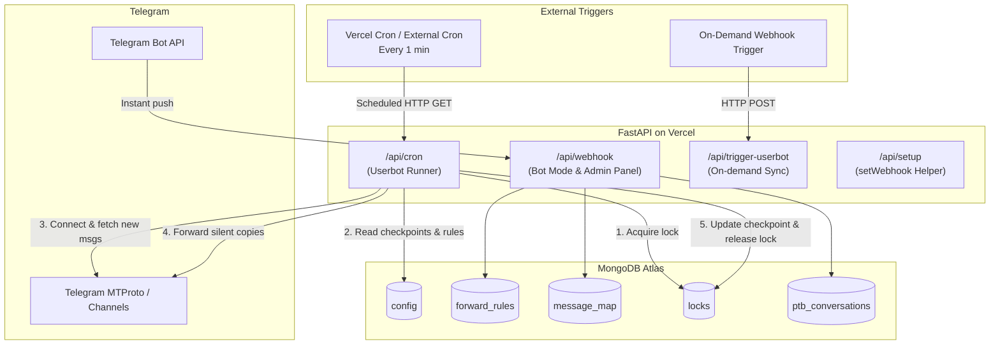

# ⚡ CT-Forwards — Serverless Edition (Webhook & Cron Driven)

A completely serverless rewrite of **Common Thread Auto Forward Bot** designed for **Vercel**, AWS Lambda, or any serverless runtime.

---

## 🎯 Why Serverless?

| Feature | Original Version | Serverless Version |
|---|---|---|
| **Runtime Model** | Long-running 24/7 server / container | Stateless on-demand functions (0 idle cost) |
| **Userbot Execution** | Persistent MTProto TCP connection | **Cron-driven pull & forward** (every 1 min or on-demand webhook) |
| **Bot Mode & Admin Panel** | Long polling via PTB | **Instant Telegram Webhooks** (`/api/webhook`) |
| **State & Multi-step Menus** | In-memory `ConversationHandler` | **MongoDB-backed persistence** (`MongoPersistence`) |
| **Concurrency Guard** | Single process assumed | **Distributed TTL locking** in MongoDB |
| **Hosting Cost** | Requires active VPS / Koyeb container | Free tier compatible on Vercel / Supabase / Upstash |

---

## 🏗️ Architecture



---

## 🚀 How the "Webhook Userbot" Works

Telegram MTProto (user accounts) does not support native webhook push from Telegram's servers — MTProto is a client protocol. 

To run userbot forwarding in a serverless, zero-polling architecture:
1. **Scheduled Cron Trigger**: Vercel Cron sends an HTTP request to `/api/cron` every minute.
2. **On-Demand Webhook Trigger**: Any external system can also call `POST /api/trigger-userbot` (with `Authorization: Bearer <CRON_SECRET>`) to run an immediate forwarding cycle.
3. **Stateless Telethon Sync**:
   - The function connects via Telethon using your saved `SESSION_STRING`.
   - Reads `last_processed_id` for each source channel from MongoDB.
   - Fetches only **new** messages (`min_id=last_processed_id`) in chronological order.
   - Preserves albums/media groups intact.
   - Filters out `skip_terms` and applies `replace_words`, `prefix`, and `suffix`.
   - Forwards to all target channels silently (`drop_author=True`).
   - Updates `last_processed_id` in MongoDB.
   - Gracefully disconnects and shuts down.

---

## 🛠️ Setup & Deployment Guide

### 1. Prerequisites
- A **MongoDB Atlas** database URI (`mongodb+srv://...`)
- Telegram **API_ID** and **API_HASH** (from [my.telegram.org](https://my.telegram.org))
- A Telethon **SESSION_STRING** (generate using `python ../generate_session.py`)
- Telegram **BOT_TOKEN** (from [@BotFather](https://t.me/BotFather))
- Your Telegram User ID for **ADMIN_IDS** (from [@userinfobot](https://t.me/userinfobot))

### 2. Deploy to Vercel

#### Option A: Deploy via Vercel CLI
```bash
cd serverless
vercel
```

#### Option B: Deploy via GitHub
1. Push your repository to GitHub.
2. Import the project in the [Vercel Dashboard](https://vercel.com).
3. If deploying from the repository root, set the **Root Directory** to `serverless` (or keep the default if deploying the folder as its own repo).
4. Configure the **Environment Variables** in Vercel project settings:

| Variable | Description |
|---|---|
| `MODE` | `userbot`, `bot`, or `both` |
| `API_ID` | Telegram API ID |
| `API_HASH` | Telegram API Hash |
| `SESSION_STRING` | Telethon StringSession |
| `BOT_TOKEN` | Bot API token for management and bot mode |
| `ADMIN_IDS` | Your Telegram user ID (e.g. `123456789`) |
| `MONGO_URL` | MongoDB connection URI |
| `MONGO_DB_NAME` | `ct_forwards` |
| `WEBHOOK_URL` | Your Vercel domain: `https://your-app.vercel.app` |
| `CRON_SECRET` | A secure random string to protect `/api/cron` |

### 3. Register the Telegram Bot Webhook
Once deployed, open your browser and visit:
```text
https://your-app.vercel.app/api/setup
```
This automatically registers `https://your-app.vercel.app/api/webhook` with Telegram and returns the registration status.

### 4. Setup 1-Minute Cron on cron-job.org (Free)
Since Vercel Hobby accounts limit native cron expressions to once daily, use a free cron service like **[cron-job.org](https://cron-job.org)**:

1. Sign up for free at [cron-job.org](https://cron-job.org).
2. Click **Create Cronjob**.
3. **Title**: `CT-Forwards Userbot Runner`
4. **URL**:
   - If using `CRON_SECRET`:
     `https://your-app.vercel.app/api/cron?secret=YOUR_CRON_SECRET`
   - If `CRON_SECRET` is not set:
     `https://your-app.vercel.app/api/cron`
5. **Execution Schedule**: Select **Every 1 minute**.
6. **Request Method**: `GET`
7. Save the cronjob. It will ping your Vercel deployment every 60 seconds to fetch new messages and forward them silently!

---

## 🧪 Local Testing

To test the serverless endpoints locally:

1. Copy `.env.example` to `.env`:
   ```bash
   cp .env.example .env
   ```
2. Install dependencies:
   ```bash
   pip install -r requirements.txt
   ```
3. Run the API:
   ```bash
   python main.py
   # Or: uvicorn api.index:app --reload --port 8000
   ```
4. Test endpoints:
   - Health check: `http://localhost:8000/api/health`
   - Trigger userbot sync: `curl http://localhost:8000/api/cron`
   - Dashboard: `http://localhost:8000/`

---

## 🔒 Security Features
- **Cron Protection**: Endpoints `/api/cron` and `/api/trigger-userbot` validate `CRON_SECRET` via `Authorization: Bearer <token>` or `?secret=<token>`.
- **Distributed Locking**: MongoDB TTL index prevents multiple cron runners from colliding or processing duplicates.
- **Admin Authentication**: All `/start`, `/menu`, and inline button clicks check `ADMIN_IDS` before executing.
- **Persistent Conversations**: `MongoPersistence` ensures multi-step admin flows survive stateless request restarts.
